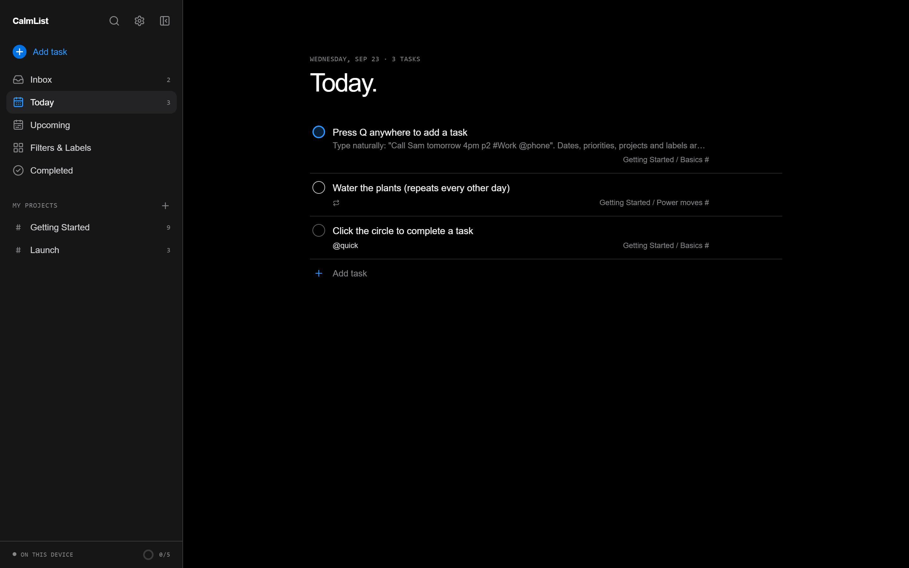
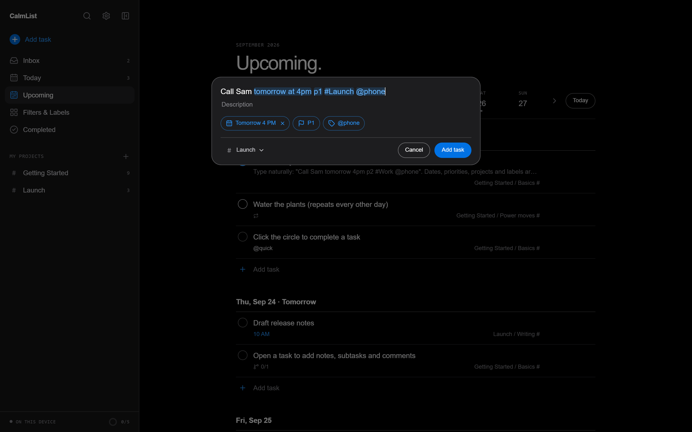
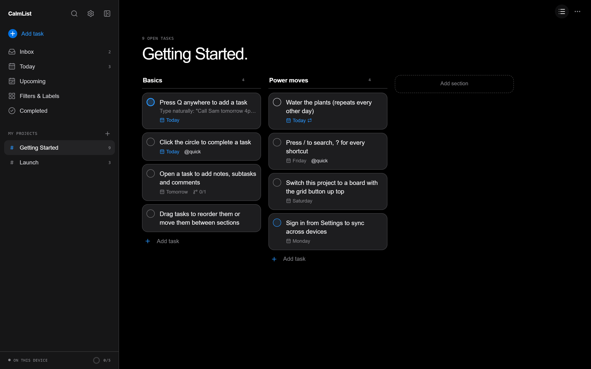
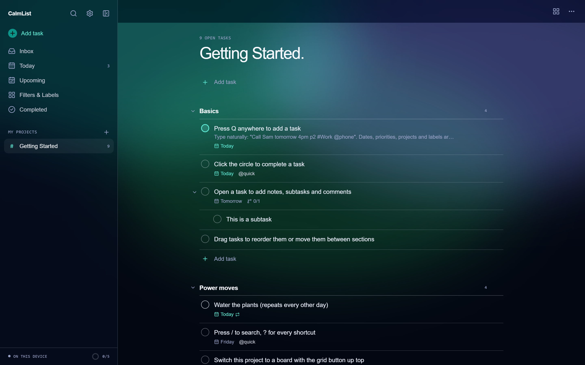
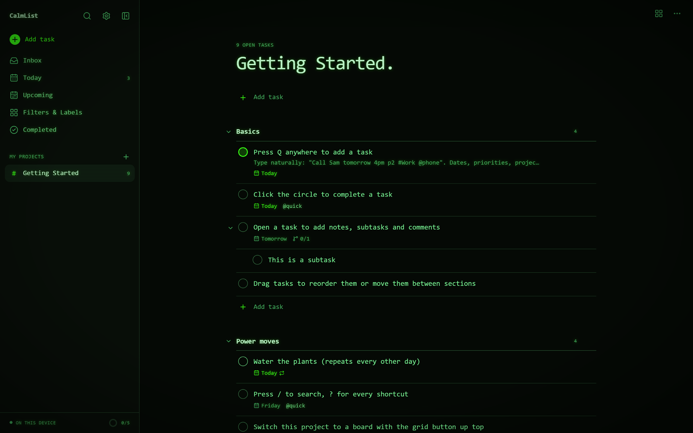
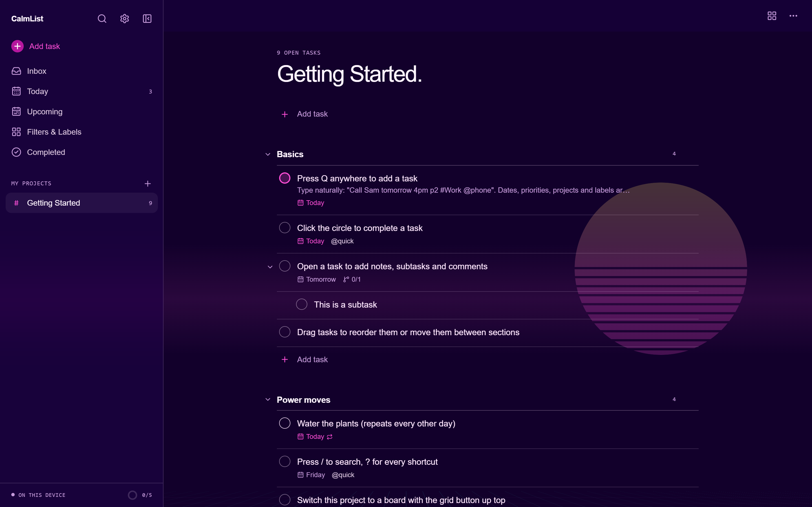
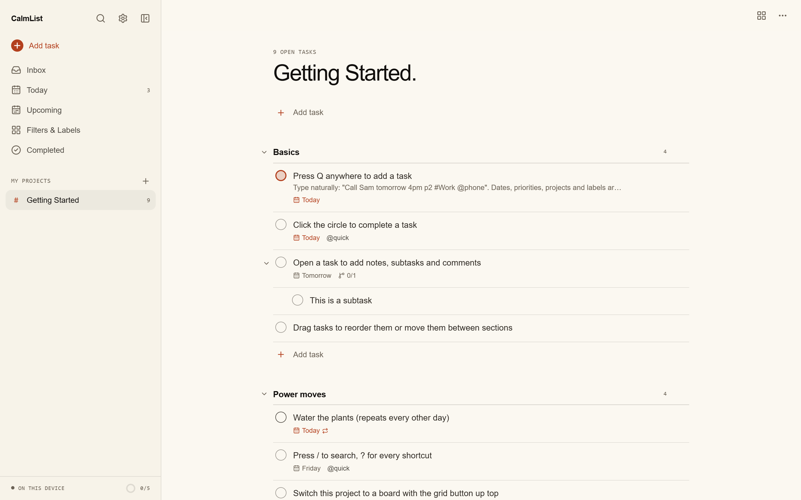

<div align="center">

# CalmList.

**Plan less. Finish more.**

A calm, keyboard-first task manager inspired by Todoist.<br />
Local-first in the browser, with free on-device AI, 48 themes, Claude and ChatGPT connectors,<br />
Google Calendar sync, and sync through Supabase or a server you host yourself.

[**Open the app**](https://calmlist.jonahchang.com/app/) · [**Website**](https://calmlist.jonahchang.com/) · [AI](#ai-free-by-default) · [Assistants](#ai-assistants-mcp) · [Apps](#install-it-as-an-app) · [Sync](#sync-options) · [Hosting](#hosting) · [Status](#service-status) · [Privacy](#privacy-licenses-and-compliance)

[](https://github.com/corund207/CalmList/actions/workflows/pages.yml)




</div>

## Features

| | |
| --- | --- |
| **Smart quick add** | Type `Call Sam tomorrow at 4pm p1 #Work @phone` and the date, time, priority, project and label are picked out and highlighted as you type. |
| **Today & Upcoming** | Overdue tasks up top with one-click reschedule, a week strip, and day-by-day planning. |
| **Repeating tasks** | `every day`, `every weekday`, `every other week`, `every mon, fri at 9am`, `every! 3 days` (counts from completion). |
| **Projects, sections, boards** | Any project can be a list or a kanban board. Drag tasks to reorder or move them between sections. |
| **Sub-tasks, notes, comments** | A full task view with descriptions, deadlines, sub-tasks and a comment thread. |
| **Labels & filters** | Saved filters in a Todoist-style query language, validated live with a match count. |
| **Command palette** | Press <kbd>/</kbd> to find any task, project, label, filter or theme, or run a query on the spot. |
| **Undo** | Completing, deleting and bulk rescheduling all come with an Undo toast. |
| **Progress** | Daily goal, streak, a 14-day chart and an activity log of what you finished. |
| **48 themes** | Dark, light, dynamic (follows the clock or the seasons), animated (aurora, starfield, synthwave, rain…) and niche (Nord, Dracula, Terminal, Pocket…), plus a custom accent colour. |
| **Free AI** | Ramble, Task Assist and Filter Assist, running on-device at no cost, or with your own Claude, ChatGPT, Gemini or Grok key. |
| **AI assistants** | Connect Claude, ChatGPT or any MCP client to read, add and complete tasks, with per-assistant tokens you can revoke. |
| **Install anywhere** | Add it to the home screen on iPhone, iPad and Android, or install it from Chrome, Edge or Safari on Mac and Windows. It opens in its own window and starts offline. |
| **Mac, Windows, iOS** | Native apps built with Tauri from the same code, a few MB each, syncing with the same account. |
| **Sync your way** | Works offline in the browser. Connect Supabase Cloud, a self-hosted Supabase, or the bundled CalmList server; offline edits queue and send on reconnect. |
| **Calendar** | Tasks and Google Calendar events together, by date and time: a month grid, a week of hours, or a list. Add events from any calendar as tasks. |
| **Integrations** | Two-way sync with a *CalmList* Google Calendar that keeps running with the app closed, .ics export for Apple and Outlook, and Todoist import (CSV). |
| **What's new** | Every release has a version number and notes, shown after each update and in Settings → General. |
| **Yours** | Export, import or delete everything at any time. No telemetry. GDPR-ready. MIT licensed. |

<table>
  <tr>
    <td width="50%"></td>
    <td width="50%"></td>
  </tr>
</table>

## Themes

Settings → **Appearance** has a gallery of 48 themes. Pick one, or choose **Match system** and assign a light and a dark theme. CI checks every palette for text contrast (4.5:1 for body text) and legible button labels.

| Group | Themes |
| --- | --- |
| **Dark** | Calm Dark (the design system default), Midnight, Graphite, OLED Mono, Forest Night, Plum, Ember |
| **Light** | Calm Light, Paper, Sky, Sage, Sand, Lilac |
| **Dynamic** | Daylight (dawn, day, golden hour, dusk, night), Night Shift (warm dark after 8 pm), Seasons, Daily Mix |
| **Animated** | Aurora, Starfield, Synthwave, Rainy Window, Lava Lamp, Digital Rain, Fireflies, Snowfall, Clouds, Ocean, Sakura, Dreamy |
| **Niche** | Terminal, Amber CRT, Pocket, Blueprint, Nord, Dracula, Gruvbox, Solarized Dark and Light, Catppuccin Mocha and Latte, Rosé Pine, Tokyo Night, Vaporwave, Coffee, E-Ink, Newsprint, Bubblegum, High Contrast |

Animated backdrops pause when the tab is hidden, cap the pixel ratio, and switch off entirely under *reduced motion* or with the **Animate theme backdrops** toggle. Type `theme` in the command palette to switch without opening settings.

<table>
  <tr>
    <td width="50%"></td>
    <td width="50%"></td>
  </tr>
  <tr>
    <td width="50%"></td>
    <td width="50%"></td>
  </tr>
</table>

## AI, free by default

CalmList has Todoist's AI features, and none of them need a paid service.

| Feature | What it does |
| --- | --- |
| **Ramble** | Talk or type freely ("I need to call the dentist tomorrow, and finish the report by Friday, p1") and review the tasks it pulls out before adding them. Dates always come from the Quick Add parser, never from a model. |
| **Task Assist** | Break a task into sub-tasks, make it more actionable, or suggest a date and priority. |
| **Filter Assist** | Describe a view in words ("urgent work stuff this week") and get a filter query. |

Pick the engine in **Settings → AI**:

| Engine | Cost | Where your text goes |
| --- | --- | --- |
| Built-in rules (default) | Free | Nowhere. Same parser as Quick Add. |
| In-browser model (Qwen 2.5, Llama 3.2 via WebGPU) | Free | Nowhere. The model downloads once, then runs offline. |
| Ollama / LM Studio / any OpenAI-compatible server | Free if you run it | Your own machine or server |
| Claude, ChatGPT, Gemini, Grok | Your own API key | That provider, only after you agree to it |

Speech uses the browser's recognizer or a private on-device Whisper model. Keys stay in the browser. Tasks proposed by AI carry an "AI" marker, to meet the EU AI Act's transparency duty.

## AI assistants (MCP)

Claude, ChatGPT and any other [MCP](https://modelcontextprotocol.io) client can use your CalmList: "what's on today?", "add *renew passport* next Monday", "move everything tagged @errands to Saturday".

1. Sign in with Supabase sync at [calmlist.jonahchang.com](https://calmlist.jonahchang.com/app/) or your own deployment (see [Hosting](#hosting)).
2. Open **Settings → Integrations → AI assistants**, pick your assistant and press **Connect**.
3. Follow the instructions shown with the token:

| Assistant | Where |
| --- | --- |
| **Claude** (web, desktop, mobile) | Settings → Connectors → *Add custom connector*, paste the URL |
| **Claude Code** | `claude mcp add --transport http calmlist https://<app>/api/mcp --header "Authorization: Bearer <token>"` |
| **ChatGPT** | Settings → Apps & Connectors → Advanced → Developer mode → *Create*, paste the URL, no authentication |
| **Others** | Streamable HTTP at `/api/mcp`, with `Authorization: Bearer <token>` or `/api/mcp/<token>` |

Gemini and Grok support is planned.

Tools: `list_tasks` (any filter query), `add_task` (with Quick Add syntax), `update_task`, `complete_task` (recurring tasks roll forward), `reopen_task`, `delete_task`, `list_projects`, `add_project`, plus `search` and `fetch` for ChatGPT's connector format.

Each assistant gets its own token. Only a SHA-256 hash is stored, and you can revoke it at any time. The endpoint has no admin key: it passes the token to two Postgres functions, `calmlist_agent_read` and `calmlist_agent_write`, which resolve it to one user and touch only that user's rows. The database tests prove a token can never reach another account.

## Install it as an app

The web app is a Progressive Web App: install it from [calmlist.jonahchang.com/app](https://calmlist.jonahchang.com/app/) and it gets its own icon, opens in its own window without browser bars, and starts even without a connection.

| Device | How |
| --- | --- |
| **iPhone, iPad** | Open it in Safari, tap **Share**, then **Add to Home Screen**. |
| **Android** | Chrome menu → **Install app** (or **Add to Home screen**). |
| **Mac** | Safari: **File → Add to Dock**. Chrome or Edge: the install icon in the address bar. |
| **Windows, Linux, ChromeOS** | Chrome or Edge: the install icon in the address bar, or menu → **Install CalmList**. |

A service worker caches the app shell on first visit and anything else (such as the on-device AI runtimes) the first time it's used. It never caches sync or AI requests. New versions are picked up on the next launch. Long-press the icon (or right-click it on desktop) for shortcuts to Today, Inbox and Upcoming.

## Mac, Windows and iOS apps

The same app, in a native window. [Tauri 2](https://tauri.app) wraps the web app in the system's own web engine (WebView2 on Windows, WebKit on macOS and iOS), so the installers are small (a few MB) and every feature behaves as it does on the web. Tasks are stored on the device, and sync through the same Supabase account.

| Platform | Get it | Notes |
| --- | --- | --- |
| **Windows 10/11** | `.msi` or `-setup.exe` from [Releases](https://github.com/corund207/CalmList/releases) or the *Native apps* workflow's artifacts | Unsigned, so SmartScreen may warn: *More info → Run anyway*. |
| **macOS 11+** (Apple Silicon and Intel) | `.dmg` from the same places | Unsigned, so right-click the app → *Open* the first time, or run `xattr -cr /Applications/CalmList.app`. |
| **iOS 16+** | See below | Installing on an iPhone needs Xcode, and TestFlight or the App Store needs an Apple Developer account. |

What differs from the web:

- Links to other sites open in your default browser.
- Email links (confirmation, password reset) and copied task links point to the hosted web app, since the native app has no web address of its own.
- **Google Calendar** is connected from the web app: Google blocks its sign-in inside embedded web views. The calendar keeps updating whenever the web app is open.
- Voice input uses on-device Whisper where the system recognizer isn't available (WebKit). The app asks for the microphone the first time you use Ramble.

### Building

```bash
npm install
npm run app:dev        # native window with hot reload (needs Rust: https://rustup.rs)
npm run app:build      # installers for this OS in src-tauri/target/release/bundle/
```

Windows needs the Visual Studio C++ Build Tools and WebView2 (built into Windows 11). macOS needs the Xcode command line tools.

**CI:** the [Native apps](.github/workflows/native.yml) workflow builds Windows, macOS (universal) and iOS on GitHub's runners. Run it from the Actions tab and download the artifacts, or push a tag (`git tag v0.1.0-beta.2 && git push --tags`) to publish a release with every platform attached; tags with a hyphen become pre-releases, and `.github/release-notes/<tag>.md` supplies the notes.

**iOS:**

- **Without a paid Apple account:** CI makes an unsigned Simulator build. On a Mac with Xcode, `npm run app:ios` runs the app on a simulator, or on your own iPhone signed with a free Apple ID (such apps expire after 7 days).
- **With an Apple Developer account ($99/year):** set the Actions variable `APPLE_DEVELOPMENT_TEAM` and the secrets `APPLE_API_ISSUER`, `APPLE_API_KEY` and `APPLE_API_KEY_CONTENT` (an App Store Connect API key). CI then builds a signed `.ipa` for TestFlight.
- **Signing and notarizing macOS:** set `APPLE_CERTIFICATE`, `APPLE_CERTIFICATE_PASSWORD`, `APPLE_SIGNING_IDENTITY`, `APPLE_ID`, `APPLE_PASSWORD` and `APPLE_TEAM_ID`. This removes the first-launch warning.

## Sync options

Open **Settings → Account & Sync** and pick where your tasks live.

| Option | Best for | Set up |
| --- | --- | --- |
| **This device** | Privacy, offline use, trying it out | Nothing. It's the default. |
| **Supabase Cloud** | Syncing with no servers to run | Create a project, apply the schema, paste the URL and anon key |
| **Self-hosted Supabase** | Owning everything, with Supabase's auth and realtime | `npm run supabase:selfhost` |
| **CalmList server** | The smallest possible footprint | `docker run` or `npm start` |

### Supabase Cloud

1. Create a project at [supabase.com](https://supabase.com/dashboard/new).
2. Apply the schema, either way:
   - **SQL editor:** paste [`supabase/migrations/20260923000000_calmlist.sql`](supabase/migrations/20260923000000_calmlist.sql) and run it. The app's *Copy Setup SQL* button copies it for you.
   - **CLI:** `npm run supabase:link -- --project-ref <ref>`, then `npm run supabase:push`.
3. In CalmList, open **Settings → Account & Sync → Supabase**, paste the project URL and the **anon public** key (Project Settings → API), press *Test Connection*, then create an account.

The schema is one table, `calmlist_items`, with row-level security (people only see their own rows), a revision trigger for incremental sync, and a realtime publication so devices update live. Hosted Supabase asks new users to confirm their email by default; you can turn that off under Authentication → Providers → Email.

### Self-hosted Supabase

Needs Docker (with the compose plugin) and git.

```bash
npm run supabase:selfhost -- --url https://tasks.example.com --app-url https://you.github.io/CalmList/app/
```

The script:

- fetches Supabase's official Docker setup into `supabase-selfhost/`
- generates every secret: Postgres password, JWT secret, signed anon and service-role keys, dashboard login, and encryption keys
- turns on email auto-confirm, since there's no SMTP by default (pass `--smtp` to keep confirmations)
- starts the stack and applies the CalmList schema
- prints the URL and anon key to paste into the app

Re-running keeps the existing secrets. `--no-start` only writes the configuration. Put HTTPS in front of port 8000 (Caddy, nginx or a Cloudflare Tunnel) before exposing it.

### Pointing the hosted app at your Supabase

Set `CALMLIST_SUPABASE_URL` and `CALMLIST_SUPABASE_ANON_KEY` in `~/apps/.env` on the server ([Hosting](#hosting)); the build then pre-fills the Supabase option. To apply migrations from CI, set the Actions variable `SUPABASE_PROJECT_REF` and the secrets `SUPABASE_ACCESS_TOKEN` and `SUPABASE_DB_PASSWORD`, and CI will run `supabase db push` on every push to `main`.

### CalmList server

The bundled server is one Node process with one SQLite file (`node:sqlite`, no native modules). It also serves the built web app, so a single container is the whole product.

```bash
docker build -t calmlist .
docker run -d -p 8787:8787 -v calmlist:/data --name calmlist calmlist
```

Or from source: `npm install && npm run build && npm start` (copy `server/.env.example` to `server/.env` first to change settings).

| Variable | Default | Purpose |
| --- | --- | --- |
| `PORT` | `8787` | Port for the API and the bundled app |
| `DATABASE_PATH` | `calmlist.db` (`/data/calmlist.db` in Docker) | SQLite file; keep it on a persistent volume |
| `CORS_ORIGIN` | `*` | Comma-separated origins allowed to call the API, e.g. `https://calmlist.jonahchang.com` |
| `STATIC_DIR` | `../../web/dist` (`_site` in Docker) | Built site or app to serve, relative to `server/src` |
| `FUNCTIONS_DIR` | `../../_functions` | The bundled MCP, stats and status-check endpoints from `npm run build:site` |

Put it behind HTTPS before using it for real accounts. To use it from another origin, set `CORS_ORIGIN` to that origin, then choose **Settings → Account & Sync → CalmList server** and enter its URL.

<details>
<summary>API reference</summary>

| Method | Path | |
| --- | --- | --- |
| `POST` | `/api/auth/signup` | `{ email, password, name? }` → `{ token, user }` |
| `POST` | `/api/auth/login` | `{ email, password }` → `{ token, user }` |
| `POST` | `/api/auth/logout` | Revokes the bearer token |
| `GET` | `/api/me` | The signed-in user |
| `GET` | `/api/sync?since=<rev>` | Changes after a revision, deletions as `data: null` |
| `POST` | `/api/sync` | `{ changes: [{ kind, id, data \| null }] }` → `{ rev }` |
| `GET` | `/api/export` | Everything the account owns |
| `DELETE` | `/api/account` | Deletes the account and its data |

Passwords are hashed with scrypt; sessions are random 256-bit bearer tokens stored only as SHA-256 hashes and expire after 90 days. Auth endpoints are rate-limited.

</details>

## Integrations

Under Settings → **Integrations**:

- **AI assistants:** connect Claude, ChatGPT and other MCP clients ([details](#ai-assistants-mcp)).
- **Google Calendar:** syncs a *CalmList* calendar both ways and brings your other calendars into the Calendar view ([details](#google-calendar)).
- **Apple, Outlook and other calendars:** download every open, dated task as an `.ics` file, with repeats written as `RRULE`s, and import it into your calendar.
- **Todoist:** in Todoist, choose a project's *Export as a template → CSV*, then import one or many files. Sections, sub-tasks (from indentation), labels, priorities, dates and comments come across.
- **JSON:** Settings → Data & Privacy exports and imports everything.

## Hosting

CalmList is served from one place: **[calmlist.jonahchang.com](https://calmlist.jonahchang.com/)**, on `macserver-1`. It runs as the `calmlist` service of macserver's public apps project (`~/apps/compose.yml`, alongside the other sites), read-only and without privileges, on a network that can't reach the server's own Supabase. The container is the CalmList server: one Node process serving the landing page, the app at `/app/`, the three endpoints (`/api/mcp`, `/api/stats`, `/api/status-check`) and the sync API. The apps Cloudflare Tunnel publishes it, so nothing listens on the network. The old addresses (GitHub Pages and `calmlist-steel.vercel.app`) only forward to the new one, first offering a download of any tasks kept in that browser.

[`deploy/`](deploy) has the service definition (`apps-service.yml`), the settings template (`apps-env.example`), `update.sh`, and the old-address forwarder (`moved.html`).

**How it's set up on macserver** (over Tailscale SSH, `ssh admin@macserver-1`):

```bash
git clone https://github.com/corund207/CalmList.git ~/apps/calmlist
# add deploy/apps-service.yml to ~/apps/compose.yml, and deploy/apps-env.example's lines to ~/apps/.env
~/apps/calmlist/deploy/update.sh --force          # build and start
crontab -e                                        # deploy each push to main:
# */2 * * * * $HOME/apps/calmlist/deploy/update.sh >> $HOME/apps/calmlist-deploy.log 2>&1
```

In Cloudflare Zero Trust → Networks → Tunnels → **macserver-apps** → Public hostnames, `calmlist.jonahchang.com` points to `http://calmlist:8787`; Cloudflare keeps the DNS record. The portfolio at `jonahchang.com` is separate. In Supabase → Authentication → URL Configuration, the Site URL is `https://calmlist.jonahchang.com/app/`, with `https://calmlist.jonahchang.com/app/**` among the redirect URLs, so confirmation and password-reset emails land in the app.

| `~/apps/.env` | Needed for | Where it comes from |
| --- | --- | --- |
| `CALMLIST_SUPABASE_URL`, `CALMLIST_SUPABASE_ANON_KEY` | Sync, accounts, MCP | Supabase → Project Settings → API (the **anon public** key) |
| `CALMLIST_SUPABASE_SERVICE_ROLE_KEY` | `/api/stats` and the status checks only | Same page. Stays on the server; never baked into the app |
| `CALMLIST_CRON_SECRET` | Status checks every 30 minutes | Any long random string, e.g. `openssl rand -hex 32` |
| `CALMLIST_GOOGLE_CLIENT_ID`, `CALMLIST_GOOGLE_CLIENT_SECRET` | Google Calendar | The OAuth web client ([below](#google-calendar)) |
| `CALMLIST_GOOGLE_TOKEN_KEY` | Google Calendar | `openssl rand -hex 32`; encrypts the stored Google sign-ins |

**Deploying:** push to `main` and cron picks it up within two minutes. To deploy at once, run `npm run deploy` from your computer (it runs `update.sh --force` over Tailscale SSH). Logs: `docker compose -f ~/apps/compose.yml logs -f calmlist`.

**Every account is separate.** All accounts share one database, but row-level security scopes every row to its owner, both for the app (the signed-in user's JWT) and for assistants (the token resolves to one user inside Postgres). `npm run test:db` runs the migrations against an in-memory Postgres and checks that no account can read, change or delete another's data.

**Security headers.** The server sends HSTS, `nosniff`, a strict referrer policy, a permissions policy and a Content-Security-Policy with no inline scripts. `connect-src` stays open because you can point the app at your own Supabase, Ollama or AI server.

### Google Calendar

With an account on the CalmList server, Google Calendar sync runs on the server, so it keeps going with every app closed:

- **The CalmList calendar syncs both ways.** Dated tasks become events (all-day for a date, 30 minutes for a time, repeats as RRULEs). Events you add or move there, on any device, become or update tasks in the Inbox. Deleting an event deletes a task that came from Google; for a task made in CalmList it only clears the date.
- **Your other calendars feed the Calendar view.** Their events appear next to your tasks; **Add** makes one a task, **Skip** hides it. Picked events stay where they are and aren't copied into the CalmList calendar.
- **Changes arrive within seconds.** Google calls `/api/google/push` when a watched calendar changes, the server syncs, and open apps hear about it over `/api/live`. A poll every 10 minutes covers any gap.

Connecting asks for `calendar.app.created` (manage only calendars CalmList made) and `calendar.readonly` (read the others). The server keeps a refresh token encrypted with AES-256-GCM, and disconnecting revokes it and deletes the CalmList calendar. Accounts without a CalmList server (Supabase or local) get the older one-way, browser-only sync, which needs a click to resume each hour.

To set it up:

1. In [Google Cloud Console](https://console.cloud.google.com/), create a project and enable the **Google Calendar API**.
2. Set up the Google Auth Platform: branding with the privacy policy (`https://<app>/legal.html#privacy`), an External audience, and the scopes `openid`, `userinfo.email`, `calendar.app.created` and `calendar.readonly`.
3. Create an **OAuth client** of type *Web application* with your site (and `http://localhost:5173` for development) as JavaScript origins, and add a client secret.
4. On macserver, set `CALMLIST_GOOGLE_CLIENT_ID`, `CALMLIST_GOOGLE_CLIENT_SECRET` and `CALMLIST_GOOGLE_TOKEN_KEY` in `~/apps/.env`, then run `npm run deploy`.

While the app is in Google's *Testing* mode, only the test users you add can connect. Opening it to everyone needs Google's verification of `calendar.readonly`, a sensitive scope.

## Releases

Every release, major, minor or patch, has a version number and a *What's new* entry in [`web/src/releases.ts`](web/src/releases.ts). The newest entry is the running version, `package.json` carries the same number (a test checks), and the app shows the notes once after each update and any time under Settings → General.

## Service status

Live numbers from the hosted service. They are aggregate counts only; no one is identified.


| Measure | Source |
| --- | --- |
| Status, uptime (24 h, 7 d, 30 d), median latency | The server probes the Supabase REST API, Supabase Auth and the app every 30 minutes (`/api/status-check`). Results are kept 90 days. |
| Accounts, active in 1 / 7 / 30 days | Counts of `auth.users` and their last sign-in |
| Syncing in 7 days | Accounts that changed any item in the last week |
| Compute | Supabase Free plan: shared CPU and 500 MB RAM (Nano), 500 MB database, 5 GB egress; pauses after a week without traffic. The site and endpoints run on macserver. |
| Database version | `db_version` in the JSON |

All of it is at [`/api/stats`](https://calmlist.jonahchang.com/api/stats) as JSON, cached for five minutes. The numbers come from `calmlist_service_stats()`, which only the service role can call.

The status checks start once `CALMLIST_CRON_SECRET` and `CALMLIST_SUPABASE_SERVICE_ROLE_KEY` are set in `~/apps/.env` on macserver.

## Privacy, licenses and compliance

- **No telemetry.** No analytics, error-reporting, ads or tracking SDKs, and no cookies beyond sign-in. Don't enable Cloudflare Web Analytics without updating the privacy policy first.
- **What leaves the device, and when.** The [Terms & Privacy page](site/legal.html) lists every destination: the sync service, AI providers you consent to, model downloads, Google Calendar and connected assistants. Settings → Data & Privacy repeats the summary in the app.
- **GDPR.** Legal bases, recipients, transfers, retention and rights are documented. People can export everything (Art. 15/20), correct it (Art. 16) and delete their account instantly (Art. 17) in the app. Sign-up records the accepted policy version, when it was accepted, and age confirmation (16+).
- **ePrivacy.** Only strictly necessary local storage, so no cookie banner is needed.
- **EU AI Act.** Cloud AI needs explicit consent per provider; AI-made tasks, including those added by assistants, are labelled.
- **Licenses.** CalmList is MIT. `npm run build:site` writes `licenses.txt` with every shipped dependency and its license text, linked from the site footer and the app.


## Quick start

Requires **Node 24+**.

```bash
git clone https://github.com/corund207/CalmList.git
cd CalmList
npm install
npm run dev            # web app on http://localhost:5173 (local mode)
npm run dev:server     # CalmList server on http://localhost:8787 (optional, proxied at /api)
```

With both running, open **Settings → Account & Sync → CalmList server**, leave *Server* blank and create an account.

| Script | What it does |
| --- | --- |
| `npm run dev` | Vite dev server for the web app |
| `npm run dev:server` | CalmList server with file watching |
| `npm run build` | Production build of the web app (`web/dist`) and server typecheck |
| `npm run build:site` | The deployable site in `_site/` (landing page, app at `/app/`, `licenses.txt`) and the bundled endpoints in `_functions/` |
| `npm start` | Runs the server, which also serves `web/dist` on the same port (or the whole site with `STATIC_DIR=../../_site`) |
| `npm run deploy` | Deploys `main` to macserver now, over Tailscale SSH |
| `npm test` | Web unit tests (Vitest), API and site tests and database isolation tests (`node:test`, PGlite) |
| `npm run typecheck` | TypeScript across the workspaces and the endpoints |
| `npm run supabase:selfhost` | Sets up and starts a self-hosted Supabase for CalmList |
| `npm run supabase:link` / `supabase:push` | Links a hosted Supabase project and applies the schema |

## Quick add syntax

| Type | Example | Result |
| --- | --- | --- |
| Date | `today` `tomorrow` `friday` `next week` `in 3 days` `oct 5` `12/31` `2026-11-02` | Due date |
| Time | `at 4pm` `9:30am` `17:00` `at noon` | Due time (a bare time means today, or tomorrow if it has passed) |
| Repeat | `every day` `every weekday` `every other week` `every mon, fri` `monthly` `every! 3 days` | Recurrence |
| Priority | `p1` `p2` `p3` `p4` | Priority (P1 is most urgent) |
| Project | `#Work` `#Home Renovation` | Project (created if new) |
| Section | `/Q4 Plans` | Section in the chosen project |
| Label | `@phone` | Label (created if new) |
| Deadline | `{oct 30}` | Deadline, separate from the due date |

## Filter syntax

Combine terms with `&` (and), `|` or `,` (or), `!` (not) and parentheses.

| Term | Matches |
| --- | --- |
| `today` `tomorrow` `overdue` `no date` | By due date |
| `7 days` `next 14 days` | Due within the next N days |
| `due before: next week` `due after: oct 1` | Relative to any date phrase |
| `p1` … `p4` `no priority` | By priority |
| `#Work` `@phone` `@home*` `/Writing` | Project, label (with wildcard), section |
| `recurring` `subtask` `no labels` `deadline` | By shape |
| `search: invoice` | Text in the name or description |

Example: `(today | overdue) & #Work & !@waiting`

## Keyboard shortcuts

| Key | Action |
| --- | --- |
| <kbd>Q</kbd> | Quick add |
| <kbd>/</kbd> | Search, commands and themes |
| <kbd>G</kbd> then <kbd>I</kbd> / <kbd>T</kbd> / <kbd>U</kbd> / <kbd>F</kbd> / <kbd>C</kbd> | Inbox, Today, Upcoming, Filters & Labels, Completed |
| <kbd>M</kbd> | Toggle the sidebar |
| <kbd>?</kbd> | Show all shortcuts |
| <kbd>Enter</kbd> / <kbd>Ctrl</kbd>+<kbd>Enter</kbd> | Save a task |
| <kbd>Esc</kbd> | Close or cancel |

## How it works

```
web/                 React 19 + Vite + TypeScript
  src/lib/           pure logic: date parser, quick add, recurrence, filters, .ics, Google Calendar, Todoist CSV (unit tested)
  src/ai/            Ramble, Task Assist, Filter Assist; rules, WebGPU, Ollama and cloud engines; speech
  src/agent/         the MCP server: tools and JSON-RPC, shared by the /api/mcp endpoint and tests
  src/store/         Zustand store, sync providers (local, CalmList, Supabase), actions with undo
  src/themes/        48 themes, the palette → token engine, animated backdrops, the gallery
  src/components/    task rows, editor, pickers, dialogs, drag and drop, settings
  src/views/         Today, Upcoming, Project/Board, Filters & Labels, Completed, Search
  sw.js              the service worker for the installed app (filled in by vite.config.ts)
server/              Hono on Node 24, node:sqlite, runs TypeScript natively; serves the site, endpoints and sync API
functions/           the endpoints /api/mcp, /api/stats, /api/status-check (web-standard handlers)
deploy/              macserver: Docker Compose with a Cloudflare Tunnel, the auto-deploy timer, the old-address forwarder
src-tauri/           the native shell for Windows, macOS and iOS (Tauri 2)
supabase/            Supabase CLI config, migrations, and the user-isolation tests
scripts/             build-site.mjs (site, licenses, bundled endpoints), supabase-selfhost.mjs
site/                landing page, Terms & Privacy
```

Every record (task, project, section, label, filter, comment, completion event) is a JSON document. The client applies changes locally first and computes their inverse for undo. Remote providers share one backend, with an offline cache and an outbox, and differ only in transport. The CalmList server and Supabase both stamp each write with an increasing revision, so clients pull only what they have not seen, and Supabase also pushes changes over realtime. Conflicts resolve last write wins.

The UI follows the [Jonah Chang design system](https://claude.ai/artifact/FcShiF9BeJoJ54daksaej8): pure black ground, graphite surfaces, one blue for action, pill buttons, hairline lists and the SF system stack. Priority is shown by ring weight rather than extra hues. Other themes swap the palette through the same tokens.

## Deployment status

| Piece | Where | State |
| --- | --- | --- |
| Website, app, MCP, stats | [calmlist.jonahchang.com](https://calmlist.jonahchang.com/) on `macserver-1` | Deploys every push to `main` within two minutes |
| Supabase project | `calmlist` in the PersonalProgects org, us-east-2 (`ddvtufcbrvzjislojlqp`) | Schema applied, row-level security and realtime on |
| Hosted app → Supabase | `CALMLIST_SUPABASE_URL`, `CALMLIST_SUPABASE_ANON_KEY` in `~/apps/.env` | Set: the Sync tab comes pre-filled |
| Old addresses | [corund207.github.io/CalmList](https://corund207.github.io/CalmList/), [calmlist-steel.vercel.app](https://calmlist-steel.vercel.app/) | Forward to calmlist.jonahchang.com |
| Migrations | `supabase/migrations/` | All applied to the hosted project |

## What you still need to do

**For the move to calmlist.jonahchang.com:**

- **Service-role key on macserver:** set `CALMLIST_SUPABASE_SERVICE_ROLE_KEY` (Supabase → Project Settings → API) in `~/apps/.env`, then `npm run deploy`. `CALMLIST_CRON_SECRET` is already set. Until then `/api/stats` answers 503 and the badges show nothing.
- **Supabase redirect URLs:** in [Authentication → URL Configuration](https://supabase.com/dashboard/project/ddvtufcbrvzjislojlqp/auth/url-configuration), set the Site URL to `https://calmlist.jonahchang.com/app/` and add `https://calmlist.jonahchang.com/app/**`, so confirmation and reset emails open the app.
- **AI assistants:** reconnect Claude, ChatGPT or other MCP clients with `https://calmlist.jonahchang.com/api/mcp`. The old Vercel address forwards, but not every client follows redirects.
- **Google Calendar:** open Settings → Integrations → Google Calendar on calmlist.jonahchang.com and press **Connect** (the Google Cloud project `calmlist` is set up).
- **Privacy contact:** the GDPR needs a way to reach you privately. Add a contact email to `site/legal.html` (it currently points to GitHub issues). If you target Germany or Austria, also add an Impressum with a postal address.
- **EU data residency (optional):** the Supabase project is in us-east-2. For EU users, a project in an EU region (e.g. Frankfurt) avoids the transfer to the US entirely.

**From before:**

1. **Create your account.** Open the [app](https://calmlist.jonahchang.com/app/) → **Settings → Account & Sync → Supabase** → *Create account*. New accounts get a confirmation email; after clicking it, come back and sign in.
2. **Optional: skip email confirmation.** Supabase's built-in email sender is rate-limited, so for a personal instance you may prefer turning off *Confirm email* under Authentication → Providers → Email in the [dashboard](https://supabase.com/dashboard/project/ddvtufcbrvzjislojlqp/auth/providers).
3. **Optional: automatic migrations.** Add the Actions variable `SUPABASE_PROJECT_REF=ddvtufcbrvzjislojlqp` and the secrets `SUPABASE_ACCESS_TOKEN` (from [account tokens](https://supabase.com/dashboard/account/tokens)) and `SUPABASE_DB_PASSWORD` (in your local, gitignored `supabase/.env.local`). CI will then push new migrations on every merge to `main`.

**Self-hosting instead:** install Docker, run `npm run supabase:selfhost -- --url https://your-domain`, put HTTPS in front of port 8000, and paste the printed URL and anon key into the app. Or run your own copy of the CalmList server image (see [Hosting](#hosting)) and choose **Settings → Account & Sync → CalmList server**.

## License

[MIT](LICENSE) © 2026 Jonah Chang
